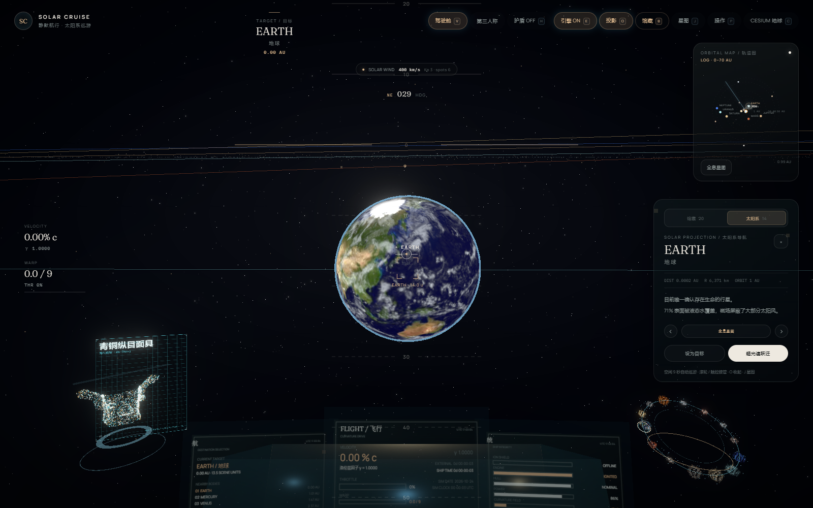
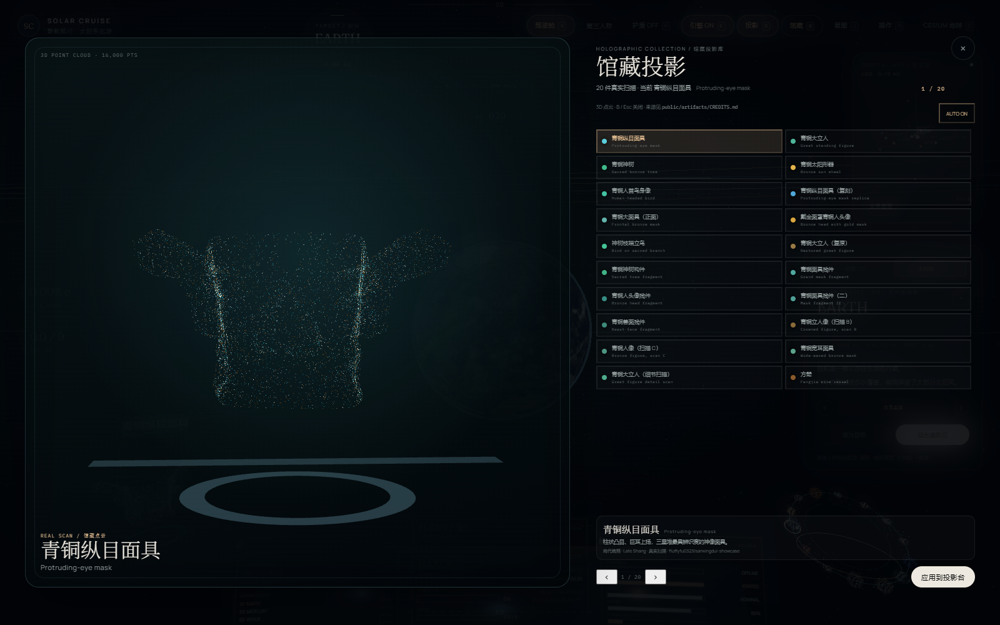
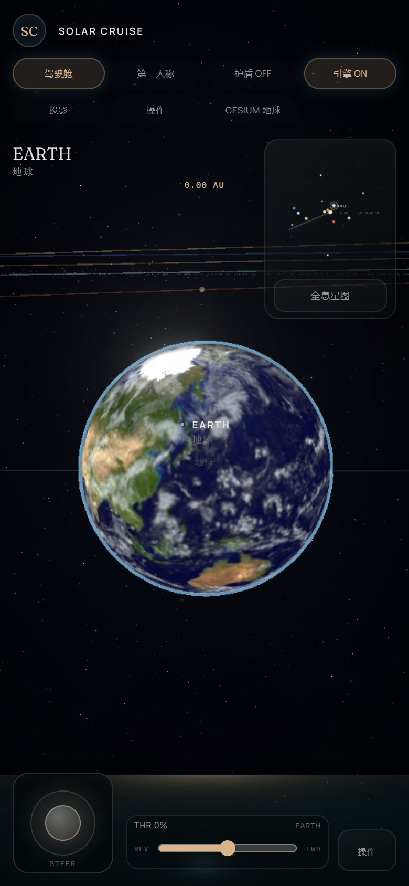
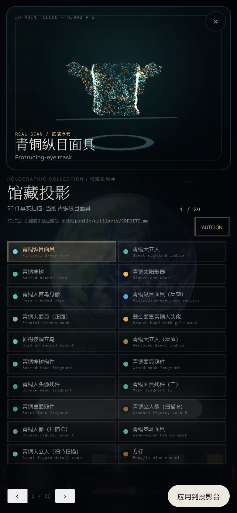
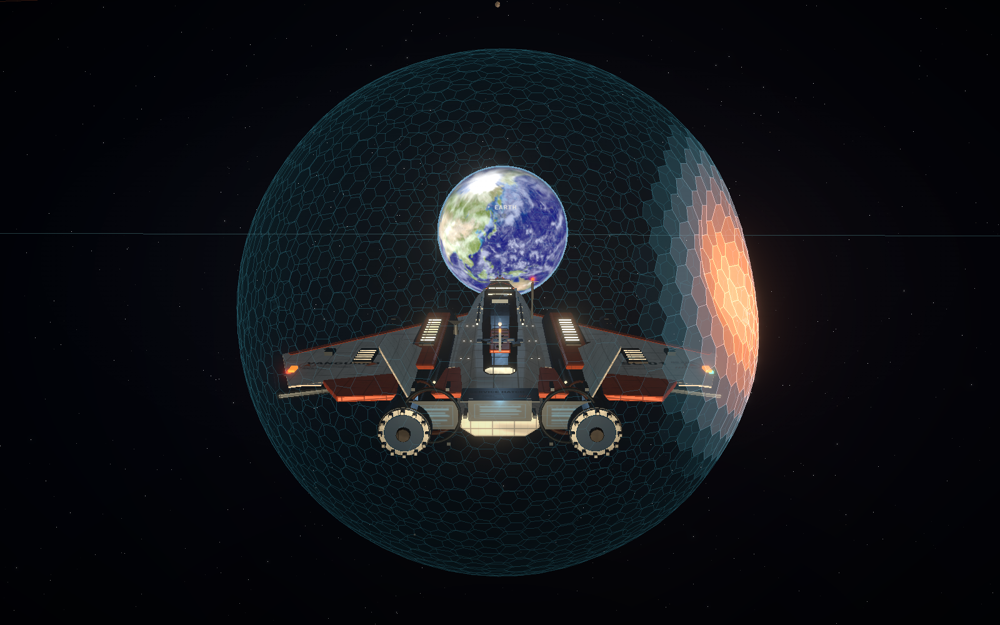

# SOLAR CRUISE · 太阳系漫游

第一人称/第三人称的太阳系曲率飞船体验。驾驶“先驱者号”离开地球，在按真实尺寸比例搭出的太阳系里飞行、跃迁、切换左右两台全息投影（馆藏 / 太阳系），或者切到 Cesium 俯瞰地球。右上角小地图显示你在太阳系的位置；鼠标拖动画面环视，不再被画布锁定。





## 这是什么

这是一个可玩的太空探索纵切片，不是完整太空模拟器。你现在能做这些事：

- 在驾驶舱和第三人称视角之间切换，手动飞行或交给 PID 自动驾驶。
- 用真实行星半径与真实行星轨道距离游览太阳系；主要卫星使用真实轨道半径。
- 打开多套导航/全息界面：轨道图、驾驶舱左右两台实体投影（左侧馆藏玻璃投影 / 右侧太阳系粒子环）、全屏 3D 全息星图。
- 在馆藏投影库浏览与切换 20 件三星堆真实扫描点云；抽象粒子形态已退出投影界面。
- 手动打开六边形离子护盾（默认关闭），处理太阳活动、随机小行星接近和护盾撞击。
- 在手机上用触控完成所有操作。

## 第一次出航

1. 启动项目，点击“进入驾驶舱”。
2. 按住画面拖动即可 360° 环视（不会接管鼠标）；右上角小地图显示你的位置。
3. 按 `W` 朝视线方向转向并推进；按住 `S` 越过 0 进入反推；按 `1`–`9` 直接进曲率档；按 `Shift` 加力。
4. 看屏幕顶部当前目标，按 `J` 打开全息星图选目标，按 `Space` 跃迁过去；按 `Y` 打开全部目的地（行星 / 卫星 / 彗星，共 41 个）。
5. 按 `O` 收放两台投影；投影卡顶部 tab 在馆藏 / 太阳系之间切换，按 `B` 或点顶部 `馆藏` 直接打开 20 件扫描投影库。
6. 按 `H` 打开/收起护盾。听到/看到 MAYDAY 时注意小行星来袭（默认每 2–4 分钟一次）；`K` 可主动触发一次测试。
7. 按 `C` 进入 Cesium 地球视图，再按 `C`（或 `Esc`）返回太空；按 `V` 切换驾驶舱/第三人称；按 `M` 开关座舱撞击音效。

## 操作

| 输入                             | 功能                                                          |
| -------------------------------- | ------------------------------------------------------------- |
| `W` / `S`                        | W 朝当前视线方向转向并推进 / S 反推（S 可进入倒退）           |
| `Shift`                          | 加力                                                          |
| `0`–`9`                          | 直接设定曲率档位                                              |
| 方向键                           | 飞船俯仰 / 偏航                                               |
| `A` / `D`                        | 滚转                                                          |
| 鼠标拖拽 / 手机单指拖动          | 驾驶舱与追尾视角 360° 环视；不锁定鼠标指针                    |
| `B` / 顶部 `馆藏`                | 打开 / 关闭 20 件真实扫描馆藏投影库                           |
| 右上角小地图                     | 显示太阳系轨道与你的位置（YOU）；点击天体或 `全息星图` 进入   |
| `Space`                          | 跃迁到当前目标（星图打开时跃迁到预览天体）                    |
| `J` / 顶部 `星图`（桌面）        | 打开 / 关闭全屏 3D 全息星图；手机从小地图按钮进入             |
| `Y` / 星图内 `全部目的地`        | 打开 / 关闭完整目的地菜单（41 个行星 / 卫星 / 彗星）          |
| `O` / 顶部“投影”                 | 打开 / 收起驾驶舱两台全息投影                                 |
| 投影卡 `馆藏 · …` / `打开馆藏库` | 打开 20 件真实扫描馆藏投影库                                  |
| 滚轮                             | 切换当前聚焦投影：馆藏下一件 / 太阳系下一个天体               |
| `V`                              | 驾驶舱 / 第三人称                                             |
| `H`                              | 离子护盾开 / 关（默认关闭，起飞后手动开启）                   |
| `E`                              | 引擎点火 / 关闭                                               |
| `T`                              | 星历时间倍率（暂停 / 1× / 1 天每秒 / 10 天每秒 / 1 年每秒）   |
| `R`                              | 扫描邻近天体                                                  |
| `C` / `Esc`                      | 进入 Cesium 地球 / 返回太空（`Esc` 也关闭星图、馆藏库、手册） |
| `X`                              | 全停：油门与曲率归零                                          |
| `K`                              | 触发一次小行星接近 / 撞击测试                                 |
| `G` / `F`                        | 自动驾驶：位置保持 / 飞向目标                                 |
| `P`                              | 飞行手册                                                      |

驾驶舱里是**两台独立投影**：左侧馆藏投影把 20 件真实扫描以 **3D 点云**悬浮在透明玻璃背板前（自转、上下浮动、扫描带扫过，背板只做边框与铭牌，不压平粒子），右侧太阳系投影保留粒子星球导航环；点哪台投影或投影卡顶部的 `馆藏 / 太阳系` tab，哪台就获得滚轮与方向键焦点。馆藏默认每 8 秒自动巡展下一件；全屏星图打开且 9 秒无操作时才自动巡游下一个天体，驾驶舱内不会把你正在看的目标悄悄换掉。打开馆藏库时自动巡展暂停。

鼠标只在**按住拖动**时改变视线；画布不再请求 pointer lock，因此 HUD、投影卡、馆藏库、护盾和星图按钮始终可点击。右上角小地图常驻，桌面和手机都能一眼看到自己在太阳系中的位置。

### 手机

- 单指拖动可环视；左下虚拟摇杆控制俯仰 / 偏航。
- **左下虚拟摇杆和底部双向油门常驻**，不放进面板：油门条左半段为倒退，右半段为前进。
- 其余指令在右下角 `操作` 卷轴里，点开展开成 5 列高密度按钮（WARP、滚转、HOLD/FLY/POINT、扫描、跃迁、星图、目的地、投影、全停、撞击），再点收起。
- 顶部按钮在窄屏手机上按 4 列网格排列，不再出现单独一行的按钮；右上角小地图常驻，点 `全息星图` 进入星图。
- 横屏手机自动切换为全宽底部操控台、隐藏小地图与目标卡，投影卡、星图和目的地菜单仍可完整滚动操作。
- **移动端默认不显示居中的投影大卡**，先看到的是干净、按真实比例排布的太阳系和右上角小地图；点顶部 `投影` 才打开紧凑玻璃卡。卡内的预览窗是真正的 3D 点云 / 3D 太阳系，不是平面缩略图。全屏星图与馆藏库的预览同样是 3D 点云。
- 面板宽度按内容分级：投影卡、扫描卡、小地图、操作卷轴互不同宽，避免所有面板都撑满横向。



## 小行星、彗星与撞击：真实到什么程度？

这一节直接回答“是不是真实数据”的问题，避免 README 夸大：

| 对象           | 当前实现                                                                                                                                                                                                        |
| -------------- | --------------------------------------------------------------------------------------------------------------------------------------------------------------------------------------------------------------- |
| 小行星带       | 240 个实例共用同一个真实 Helion 岩石扫描模型（带 256px 真实纹理），分布在真实主带 2.08–3.28 AU；另有 2400 个环境尘埃点。位置为程序化散布，**不是**逐颗真实小行星星历；形状/材质是真实岩石模型而非程序化多面体。 |
| 小行星尾流     | **没有**：背景尘埃不是单颗小行星的尾流；来撞击的小行星也没有拖尾。                                                                                                                                              |
| 柯伊伯带       | 2400 个示意点，分布在约 30–50 AU，不是逐个真实天体。                                                                                                                                                            |
| 撞击测试小行星 | 真实 Helion 岩石 GLB（Meshopt 压缩、256px 纹理），从视线前侧进入并在视野内可见；不再是程序化十二面体，也没有红色标记球。                                                                                        |
| 四颗彗星       | 使用公开轨道要素做近似轨道；67P 使用真实 67P 形模，其余三颗共用 Tempel 1 真实形模作替身，并非各自真实核形。靠近阈值后才加载真实彗核 GLB，远处不显示程序化替身。                                                 |
| 彗尾           | 有：固定种子生成的 240 点抗太阳方向粒子锥，带辉光。方向会随太阳位置变化，但长度不随日心距/太阳活动变化，没有离子尾/尘埃尾分离，也没有太阳风动力学。                                                             |
| 撞击特效       | 有：护盾六边形变形与颜色渐变、点光 sprite、全屏白色冲击闪光、MAYDAY 警报、相机方向性抖动、座舱独立晃动、程序化金属嘎吱与结构闷响、船体角冲量。**没有**碎片、火花、爆炸或手柄震动。                              |
| 第一人称震动   | 有。撞击按相对速度、法向入射角和小行星质量算出 severity，驱动相机抖动、座舱模型独立晃动和音效强度；角冲量由切向速度计算，不再用随机数。护盾蜂窝变形仍只在第三人称可见。                                         |

所以：**可触摸到的小行星/彗核都用真实模型；小行星分布、彗星轨道与彗尾仍是程序化近似。**

### 撞击反馈现在怎么算

撞击发生时不是固定播放一段动画，而是先算飞行状态：

- **相对速度** = 小行星世界速度 − 飞船世界速度。
- **法向占比** = |v_rel · n| / |v_rel|；正面撞比擦边撞更重。
- **等效质量** = 小行星尺寸³；每次接近的尺寸会随机。
- **估算能量** = ½ · m · v_rel²。

这些量合成 `severity`，再分别驱动：护盾形变/颜色、相机方向性抖动、座舱模型独立晃动、撞击音效强度与声像、船体推离速度，以及由切向速度计算出的角冲量。音效在第一次点击后由 Web Audio 解锁；`M` 静音。

如果你要更真实的一版，下一步应优先补：单颗小行星的粒子尾流、碎片/火花/冲击波、控制器震动，以及把彗尾长度绑定到日心距和太阳活动。注意：真实的太阳系里小行星相互之间极其稀疏，主带不会像游戏里那样密集；本项目把真实岩石模型缩放到可辨认的尺寸，但把它们放在正确的 2.08–3.28 AU 主带，而不是堆在内部太阳系。

## 世界与全息

- 行星/矮行星使用真实公里半径按同一比例换算；行星轨道使用真实半长轴；主要卫星使用真实轨道半径，少数不规则卫星仍是近似值。
- 行星贴图来自公开真实地图；月球/火星有真实地标、NASA 登月舱与毅力号模型。
- 驾驶舱右侧太阳系投影的环形图包含太阳与全部行星/矮行星，均为贴图采样粒子星球，不使用实心球；左侧馆藏投影是真实的 3D 扫描点云悬浮在玻璃背板前，不使用抽象粒子雕塑，也不把点云烤成平面贴图。
- 全屏星图中央是选中天体的真实贴图采样粒子重建；外圈所有天体可点击/滚轮/触控选择。
- 馆藏库含 20 件三星堆真实扫描点云；打开库后是左右分栏：左侧 3D 点云玻璃屏（桌面 16,000 点 / 手机 8,000 点），右侧是**纯透明的索引面板**，选项列表独立滚动、头尾固定。馆藏颜色是展陈配色，不是文物表面测色复原。19 种程序化形态不再出现在投影界面。



## 护盾与危险事件

- 连续共边蜂窝护盾：闭合球面保留拓扑必需的 12 个五边形，其余为正六边形；撞击区域按强度向内形变并出现青→琥珀→红色渐变。
- 随机小行星接近/撞击、太阳风与耀斑/电磁干扰、MAYDAY 警报。
- 护盾蜂窝在第三人称可视；第一人称会看到 HUD 闪光、相机抖动、座舱独立晃动，并听到随撞击强度变化的嘎吱声。



## 运行

需要 Node.js 22.12+（或 20.19+）。

```bash
npm install
npm run dev
```

快速验证（资产、Meshopt、无 pointer lock、真实小行星、馆藏 `B` 快捷键）：

```bash
npm run verify:fast
```

全量移动端 QA（8 种尺寸约 161 个面板状态、逐一开关）仍是**按需**的本地浏览器审计，不在每次构建里跑：使用本机 Chrome + `npm run preview`，再运行 `.recovery/cdp-mobile-audit.cjs`（本地 QA 目录不随仓库分发）。

生产构建：

```bash
npm run build
npm run preview
```

`postinstall` 会把 Cesium 静态资源复制到 `public/cesium/`（不提交到 Git）。8K 行星贴图不进入构建/部署包；`postbuild` 会剔除 `dist/planets/8k`。调试参数：`?debug=1` 提供 `window.__cruise`；`?ship=<seed>` 切换船体变体；`?hazards=0` 关闭随机小行星。

当前冷启动只加载入口、舱体与地球预览：本机入口按钮约 0.2 秒可点，首帧约 1.2 秒，进入驾驶舱前约 0.93 MB 初始传输（静止 2.5 秒后约 1.0 MB）；4K/8K 贴图在靠近天体后按需加载。

## 已知限制

- 小行星带/柯伊伯带的**位置分布**、彗尾与撞击特效是程序化近似，不是科学仿真；小行星、彗核和座舱外形使用真实模型资产。
- 撞击仍缺少碎片、火花、爆炸和手柄震动；音效为程序化合成，不是实录材质声；第一人称看不到护盾蜂窝形变。小行星默认 2–4 分钟一次，`K` 可立即测试。
- 彗尾长度、尘埃尾/离子尾、彗核活动未做物理耦合；只有 67P 使用真实核形，其余彗星共用形模。
- 全息馆藏是真实扫描点云，但部分来源未逐件标注许可证；公开部署或商业使用前请核对 `public/artifacts/CREDITS.md`。
- Cesium 依赖在线服务，没有内置离线影像；默认叠加 Esri 卫星底图与 NASA GIBS 夜间灯光，首次进入约 1–5 秒完成影像加载，加载期间保留载入提示。
- 移动端、2K/4K 贴图、全息粒子和 Cesium 分别有 GPU/内存开销；DPR 上限 1.35。

后续方向：小行星粒子尾流、碎片/火花/冲击波、手柄震动、彗尾随日心距与太阳活动变化、行星环阴影/掩星、木星实时流体、完整星历。

## 素材与许可

代码 MIT。飞船、驾驶舱与岩石模型为 Helion Vanguard（MIT）；行星/卫星贴图主要来自 Solar System Scope 与 NASA/ESA 公开资料；Cesium 为 Apache 2.0；字体为 Manrope/Fraunces（SIL OFL 1.1）。

全息形态的粒子布局改写自 Particle Field / `particle-simulator`（MIT）。20 件三星堆扫描点云不属于 MIT 代码许可，来源、作者与授权见 [`public/artifacts/CREDITS.md`](public/artifacts/CREDITS.md) 与 [`THIRD_PARTY_NOTICES.md`](THIRD_PARTY_NOTICES.md)；其中明确标为 CC BY 4.0 的模型需保留作者与来源署名。

本项目是个人练习/粉丝向作品，不代表 NASA、ESA、CNSA 或任何航天机构。
